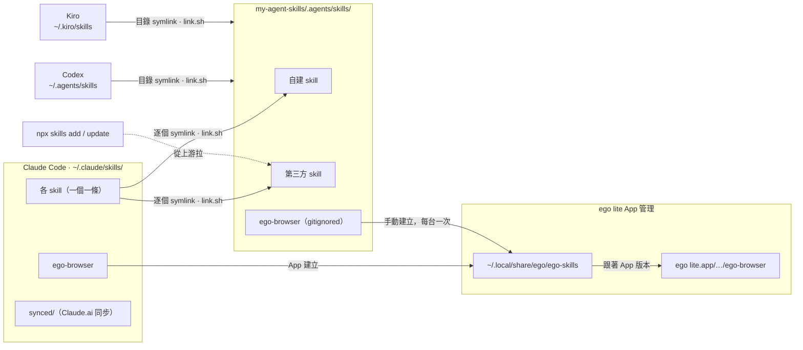

# my-agent-skills

個人的 [Agent Skills](https://agentskills.io) 策展庫，收齊我會用到的所有 skill（自建 + 第三方），供 Claude Code、Codex、Kiro 共用。全部放在 `.agents/skills/` 一個資料夾，各 agent 透過 **symlink 直接讀取**，改檔存檔即生效；第三方 skill 用 [`npx skills`](https://github.com/vercel-labs/skills) 從各自上游更新。

## 運作模型



- **自建 skill**：直接編輯 `.agents/skills/<name>/`，存檔即生效。
- **第三方 skill**：由 `skills-lock.json` 追蹤來源，只透過 `npx skills` 更新，**請勿手改**；想客製就另開一個自建 skill。
- **App 安裝的 skill**（目前只有 `ego-browser`）：檔案由 App 隨版本管理，repo 裡只放一條指向 App 安裝位置的 symlink，讓 Codex、Kiro 透過目錄 link 讀到。link 指向本機路徑，列在 `.gitignore`，每台裝了 App 的機器各自建立；Claude Code 那條由 App 自己建，`scripts/link.sh` 不碰。
- **Claude Code 為什麼逐個 link**：`~/.claude/skills/` 還放著 Claude Code 從 Claude.ai 帳號同步的 `synced/`，整個目錄不能換成 symlink，所以每個 skill 各建一條。

`scripts/link.sh` 負責建立以上所有 symlink，可重複執行：

- 已正確的 link 不動，缺的補上。
- `~/.claude/skills/` 中指向本 repo、但 skill 已不存在的 link 會被移除。
- `npx skills add/update` 會在 repo 裡另建 `.claude/skills/`（有 `.kiro/` 時還有 `.kiro/skills/`）的 project-scope link，與上面的 link 重複，一併移除；這兩個路徑也已列入 `.gitignore`。
- 目標位置若是實體檔案或資料夾，一律不碰，只回報並以非零狀態結束。

## 首次設定（新裝置）

```bash
# 1. clone repo
git clone git@github.com:jubeatt/my-agent-skills.git ~/Projects/my-agent-skills
cd ~/Projects/my-agent-skills

# 2. 建立各 agent 的 symlink（先預覽）
scripts/link.sh --dry-run
scripts/link.sh

# 3. 啟用 git hooks：commit / pull / checkout 後自動補建或清除 Claude Code 的 link
git config core.hooksPath .githooks

# 4.（有裝 ego lite 才需要）讓 Codex、Kiro 讀到 App 附的 ego-browser
ln -s ~/.local/share/ego/ego-skills .agents/skills/ego-browser
```

## 日常維護

```bash
# 改 skill：直接編輯 .agents/skills/<name>/，存檔即生效

# 新增自建 skill：建立 .agents/skills/<name>/SKILL.md
# commit 時 hook 會自動建 Claude Code 的 link；想先試用可手動跑
scripts/link.sh

# 新增第三方 skill（-a universal 讓檔案落在 .agents/skills/，不要加 -g）
npx skills add <owner>/<repo> --skill <name> -a universal -y

# 更新第三方 skill（透過 symlink 即時反映）
npx skills update

# 移除第三方 skill
npx skills remove <name> -y
```
